# Food Safety Platform

> **Worldwide platform combining food contamination education and risk guidance, a food safety information and alerts centre, an accredited laboratory testing directory, and food-business management software.**

Designed from the ground up to operate with **$0 starting capital** on verified commercial-compatible free tiers (Cloudflare Pages + Supabase PostgreSQL).

---

## 1. Distinct Platform Experiences

The architecture plans 5 distinct user experiences across public, consumer, provider, business, and administrative personas:

```mermaid
graph TD
    A[Platform Architecture] --> B[1. Public Experience]
    A --> C[2. Consumer Experience]
    A --> D[3. Laboratory Provider]
    A --> E[4. Food Business Member]
    A --> F[5. Administrator Portal]

    B --> B1[Food Contaminants Encyclopedia & Risk Guidance]
    B --> B2[Verified Public Recall Notices & Health Alerts]
    B --> B3[Scientific Disclaimers & Regulatory Reference Links]

    C --> C1[Submit Suspected Contamination Reports]
    C --> C2[Track Status of Community Concerns]
    C --> C3[Request Lab Sample Testing Quotes]

    D --> D1[Directory Profile & ISO/IEC 17025 Accreditation Scopes]
    D --> D2[Receive Testing Sample Quotation Enquiries]
    D --> D3[Verified Testing Partner Badge & Lead Analytics]

    E --> E1[Daily Sanitation & Station Checklists]
    E --> E2[Cold-Chain Fridge & Freezer Temperature Logs]
    E --> E3[Batch Expiration & Supplier Traceability]
    E --> E4[One-Click Audit CSV/PDF Compliance Reports]

    F --> F1[Moderate Citizen Incident Submissions]
    F --> F2[Publish Official Sourced Food Recalls]
    F --> F3[Approve Laboratory Directory Listings]
```



---

## 2. Security Principles

1. **Strict Secret Isolation**:
   - Only `NEXT_PUBLIC_` variables are included in client bundles.
   - `SUPABASE_SERVICE_ROLE_KEY` is **strictly restricted** to Cloudflare Pages Functions (`/functions/api/*`) or Cloudflare Workers. It is **never** referenced in frontend code.
2. **Database Row Level Security (RLS)**:
   - Every table in PostgreSQL has RLS enabled with explicit policies in `supabase/migrations/001_initial_schema.sql`.
   - Multi-tenant business isolation prevents cross-tenant data leakage.
3. **Scientific Detection Safeguards**:
   - The platform clearly communicates that visual inspection and software cannot replace laboratory testing.
   - Community incident reports remain in `under_review` status until verified by official bodies or certified testing.

---

## 3. Technology Stack & Free Tier Verification

| Component | Technology | Provider | Cost | Commercial Terms Compatibility |
| :--- | :--- | :--- | :--- | :--- |
| **Frontend** | Next.js 15, React 19, TypeScript, Tailwind CSS | Cloudflare Pages | **$0** | Permitted on free plan. Unlimited bandwidth. |
| **Server Functions** | Cloudflare Pages Functions (`/functions`) | Cloudflare | **$0** | 100,000 requests/day free allowance. |
| **Database & Auth** | PostgreSQL with RLS, Supabase Auth | Supabase | **$0** | 500 MB database, 50,000 MAUs. |
| **File Storage** | Supabase Storage | Supabase | **$0** | 1 GB storage for evidence files. |

> [!IMPORTANT]
> **Vercel Hobby Commercial Restriction**: Vercel Hobby terms explicitly prohibit commercial SaaS usage. Deploying a commercial product on Vercel Hobby violates terms of service. This project is specifically configured for **Cloudflare Pages**.

---

## 4. Local Testing & Verification Instructions

### Available Quality Assurance Commands

Run the automated checks locally:

```bash
# 1. Typecheck (Verifies TypeScript validity without emitting files)
npx tsc --noEmit

# 2. Linting (Verifies ESLint 9 code quality on src/)
npm run lint

# 3. Production Build Test (Generates optimized static prerendered output)
npm run build
```

### Actual Verification Results
- **TypeScript**: `npx tsc --noEmit` exited with code `0` (Zero type errors).
- **ESLint**: `npm run lint` exited with code `0` (Zero errors, zero warnings).
- **Production Build**: `npm run build` compiled all 11 routes statically with code `0`.

---

## 5. Deployment Guide

See [`DEPLOYMENT.md`](file:///d:/Millionaire/DEPLOYMENT.md) for full step-by-step instructions on deploying to Cloudflare Pages and running database migrations in Supabase.
